# HealthTrack

HealthTrack is a full-stack symptom tracking web app built for the AidenAI AI/ML Intern Build Round. Patients can log symptoms with a severity rating (`1–10`), switch between patient records, view chronological history, and track daily average severity over the last 30 days.

> **Prototype notice:** This project is a local demo using synthetic patient data only. It does not provide medical diagnoses, predictive analytics, or production security, and `patient_id` selection is for demo scoping rather than authentication.

## Overview and Requirement Coverage

Core capabilities:
- Log symptoms (`patient_id`, `description`, `severity`, server-generated UTC `timestamp`) to SQLite with strict server-side validation.
- Browse existing patients dynamically via `GET /api/patients` using a searchable dropdown with one-click selection, or enter a new patient ID manually; creating a symptom for a new patient updates the list automatically.
- View patient-specific history sorted newest-first in the UI (while `GET /api/symptoms` preserves ascending chronological order), summary cards across all records, and a 30-day UTC daily average severity line chart.
- Print or save a patient-specific report via **Share with Doctor** (`window.print()`), including summary statistics, 30-day trends, and complete symptom history in a print layout that hides interactive controls and keeps all data local (nothing is sent externally).
- Handle network errors, HTTP `422`/`500` responses, loading/empty states, and retry actions without losing typed form input.

| # | Requirement | Priority | Implementation | Verification | Status |
|---|---|---|---|---|---|
| 1 | Persistent DB for patient ID, description, severity (1–10), and timestamp | Must | `backend/app/models.py`, `backend/app/database.py` (SQLite + SQLAlchemy 2.x) | Automated Pytest (isolated SQLite) and server restart check | Done |
| 2 | Store and retrieve at least 5 symptom logs with unique timestamps | Must | `backend/app/services/symptoms.py`, `backend/scripts/seed_demo.py` | Automated Pytest and live 5-POST HTTP check | Done |
| 3 | `POST` endpoint rejecting empty/whitespace descriptions and invalid severities | Must | `POST /api/symptoms` (`routers/symptoms.py`, `schemas.py`) | Automated Pytest (18 `422` cases + `1`/`10` boundaries) and live HTTP check | Done |
| 4 | `GET` endpoint for patient-specific logs sorted by timestamp ascending | Must | `GET /api/symptoms?patient_id=...` (`ORDER BY timestamp ASC, id ASC`) | Automated Pytest and live HTTP check | Done |
| 5 | Frontend form, history table, and network/server error handling | Must | `SymptomForm.jsx`, `SymptomTable.jsx`, `PatientSelector.jsx`, `src/api/symptoms.js` | 15 Vitest integration tests (mocked APIs) and manual desktop inspection | Done |
| 6 | Line chart of daily average severity over the last 30 days | Could | `GET /api/symptoms/trends`, `SeverityChart.jsx` (Recharts) | Automated Pytest (`test_trends.py`), Vitest, and live HTTP check | Done |

## Tech Stack

| Layer | Choice | Why it fits this project |
|---|---|---|
| Frontend | React 19, Vite 8, Tailwind CSS 4, Lucide React | Fast local dev server, clean component structure, and responsive styling without boilerplate. |
| Charts | Recharts 3 | Responsive SVG line charts with native `connectNulls={false}` gap handling and custom tooltips. |
| Backend | Python, FastAPI, Uvicorn, Pydantic v2 | Automatic Swagger docs (`/docs`), dependency injection, and strict `StrictInt` validation. |
| Database | SQLite + SQLAlchemy 2.x | Zero-config persistent file database with `CHECK` constraints and parameterized queries. |
| Testing & Lint | Pytest, HTTPX, Vitest, React Testing Library, oxlint | Fast isolated tests across backend and frontend with no external services required. |

## Architecture

```mermaid
flowchart LR
    User["Patient (Browser)"] --> UI["React Dashboard (Vite + Tailwind)"]
    UI -->|"fetch() + AbortController"| Client["API Client (src/api/symptoms.js)"]
    Client -->|"REST JSON (/api/symptoms, /trends, /patients)"| API["FastAPI Routers (routers/)"]
    API -->|"Validate"| Schemas["Pydantic v2 (schemas.py)"]
    Schemas --> Service["Symptom Service (services/symptoms.py)"]
    Service -->|"Parameterized Queries"| ORM["SQLAlchemy 2.x (models.py)"]
    ORM --> DB[("SQLite (backend/healthtrack.db)")]
    DB -->|"Logs, Trends & Patient List"| UI
```



`App.jsx` delegates state and API calls to the `usePatientSymptoms` hook (`src/hooks/usePatientSymptoms.js`), which talks to FastAPI through `src/api/symptoms.js`. After a valid `POST /api/symptoms`, the hook refreshes history, 30-day trends, and the patient list in parallel so the UI stays in sync without a page reload.

## Project Structure

```text
HealthTrack/
├── .gitignore
├── PROJECT_PLAN.md
├── README.md
├── backend/
│   ├── .env.example
│   ├── pytest.ini
│   ├── requirements.txt
│   ├── app/
│   │   ├── config.py             # Env settings and predictable SQLite path resolution
│   │   ├── database.py           # SQLAlchemy 2.x engine, SessionLocal, init_db, get_db
│   │   ├── main.py               # FastAPI app, lifespan table init, CORS, /api/health
│   │   ├── models.py             # SymptomLog ORM model, CHECK constraints, UTCDateTime
│   │   ├── schemas.py            # Pydantic v2 request/response schemas
│   │   ├── routers/
│   │   │   ├── patients.py       # GET /api/patients
│   │   │   └── symptoms.py       # POST/GET /api/symptoms and GET /api/symptoms/trends
│   │   └── services/
│   │       └── symptoms.py       # Persistence, monotonic UTC timestamps, 30-day aggregation
│   ├── scripts/
│   │   └── seed_demo.py          # Idempotent synthetic demo data (PAT001, PAT002)
│   └── tests/
│       ├── conftest.py           # Isolated temporary SQLite fixtures per test
│       ├── test_health.py
│       ├── test_patients.py      # /api/patients listing, sorting, empty DB, 500 handling
│       ├── test_symptoms.py      # CRUD, 422 validation, ordering, DB constraints, seed tests
│       └── test_trends.py        # 30-day window, averages, null gaps, UTC boundaries
└── frontend/
    ├── .env.example
    ├── .oxlintrc.json
    ├── index.html
    ├── package-lock.json
    ├── package.json
    ├── vite.config.js            # Vite, Tailwind plugin, Recharts chunk split, Vitest config
    └── src/
        ├── App.jsx               # Dashboard layout & Share with Doctor print report
        ├── App.test.jsx          # 15 Vitest integration tests
        ├── api/symptoms.js       # Fetch wrapper and FastAPI error parser
        ├── hooks/usePatientSymptoms.js
        ├── components/
        │   ├── EmptyState.jsx
        │   ├── FeedbackMessage.jsx
        │   ├── Footer.jsx
        │   ├── Header.jsx
        │   ├── PatientSelector.jsx   # Searchable patient dropdown + manual Patient ID input
        │   ├── SeverityChart.jsx     # 30-day Recharts line chart
        │   ├── SummaryCards.jsx
        │   ├── SymptomForm.jsx
        │   └── SymptomTable.jsx
        └── utils/
            ├── formatters.js     # Local/UTC date formatting and summary stats
            └── severity.js       # Mild (1–3), Moderate (4–6), Severe (7–10) labels
```

## Local Setup

Prerequisites: Python 3.12+ (tested on 3.12.2), Node.js 20+ (tested on v24.14.1 / npm 10.9.2), and Git.

```bash
git clone https://github.com/SuhasVarmaGadiraju/HealthTrack.git
cd HealthTrack
```

### 1. Backend (Terminal 1)

Windows PowerShell (calls `.venv` directly to avoid script-activation policy issues):
```powershell
cd backend
python -m venv .venv
.\.venv\Scripts\python.exe -m pip install -r requirements.txt
Copy-Item .env.example .env   # Optional; defaults work out of the box
.\.venv\Scripts\python.exe -m scripts.seed_demo   # Optional: seed synthetic data
.\.venv\Scripts\python.exe -m uvicorn app.main:app --reload --port 8000
```

macOS / Linux:
```bash
cd backend
python3 -m venv .venv
.venv/bin/python -m pip install -r requirements.txt
cp .env.example .env          # Optional
.venv/bin/python -m scripts.seed_demo             # Optional
.venv/bin/python -m uvicorn app.main:app --reload --port 8000
```

### 2. Frontend (Terminal 2)

Both servers must run at the same time:
```bash
cd frontend
npm ci
npm run dev
```

URLs:
- Dashboard: http://localhost:5173
- Swagger UI: http://127.0.0.1:8000/docs
- Health check: http://127.0.0.1:8000/api/health

### Demo Data

`backend/healthtrack.db` is excluded from Git, so a fresh clone starts with an empty database (tables are created automatically on startup, and `PAT001` intentionally displays empty states with **Share with Doctor** disabled until a symptom is logged). Running `scripts/seed_demo.py` inserts synthetic records without deleting existing data or creating future timestamps, and can be run repeatedly without creating duplicates:
- `PAT001`: 12 logs across the last 30 UTC days (including a 5-day streak and multi-log days).
- `PAT002`: 3 logs to verify patient isolation.

## API Reference

### `POST /api/symptoms`
Creates a symptom log. `patient_id` (1–100 chars) and `description` (1–1000 chars) are trimmed and must be non-empty; `severity` must be a strict integer from `1` to `10` (rejects floats, booleans, strings, and `null`).

Request:
```json
{
  "patient_id": "PAT001",
  "description": "Headache and fatigue",
  "severity": 7
}
```
Response (`201 Created`):
```json
{
  "message": "Symptom logged successfully",
  "data": {
    "id": 1,
    "patient_id": "PAT001",
    "description": "Headache and fatigue",
    "severity": 7,
    "timestamp": "2026-11-25T14:30:00.123456Z"
  }
}
```
Returns `422` for validation errors and a generic `500` message on database failures.

### `GET /api/symptoms?patient_id=PAT001`
Returns all symptom logs for `patient_id` sorted by `timestamp` ascending, then `id` ascending (`[]` if none exist).

### `GET /api/symptoms/trends?patient_id=PAT001`
Returns 30 daily objects covering `[today_utc - 29 days, today_utc]` in ascending UTC date order. Days without logs return `average_severity: null` and `symptom_count: 0`:
```json
[
  { "date": "2026-11-24", "average_severity": null, "symptom_count": 0 },
  { "date": "2026-11-25", "average_severity": 5.5, "symptom_count": 2 }
]
```

### `GET /api/patients`
Returns distinct `patient_id` values from `symptom_logs` sorted alphabetically (`[]` if empty):
```json
[
  { "patient_id": "PAT001" },
  { "patient_id": "PAT002" }
]
```

### `GET /api/health`
Returns `{"status": "ok", "service": "healthtrack-api"}`.

## Database and Severity Analytics

The `symptom_logs` table in `backend/healthtrack.db` stores:
- `id`: Integer primary key (auto-increment)
- `patient_id`: `String(100)`, not null, indexed, `CHECK (length(trim(patient_id)) > 0)`
- `description`: `String(1000)`, not null, `CHECK (length(trim(description)) > 0)`
- `severity`: `Integer`, not null, `CHECK (severity >= 1 AND severity <= 10)`
- `timestamp`: `UTCDateTime`, not null, server-generated UTC with microsecond precision

A composite index `ix_symptom_logs_patient_timestamp_id` on `(patient_id, timestamp, id)` supports patient-scoped chronological queries. Because SQLite strips `tzinfo`, `UTCDateTime` normalizes bound datetimes to UTC and restores `timezone.utc` on read. In `create_symptom_log`, if a rapid sequential request lands on the same clock tick (`<=` the patient's latest timestamp), the timestamp advances by `+1 microsecond` so consecutive entries remain uniquely ordered.

**30-day average calculation:** For each UTC date in the last 30 days (today plus the previous 29 days), `average_severity` is `sum(severities) / symptom_count`, rounded to two decimal places. For example, three logs on one day with severities `4`, `6`, and `8` give `(4 + 6 + 8) / 3 = 6.0`. Future timestamps and older records are excluded. Missing days stay `null` rather than `0`, and Recharts uses `connectNulls={false}` so unrecorded days appear as gaps instead of interpolated lines. Summary cards compute descriptive stats across all available records for the active patient (no ML or medical predictions).

## Testing

Backend (`backend/`):
```powershell
.\.venv\Scripts\pytest.exe -v
```
- **41 passed, 0 failed** (1 benign Starlette `httpx` deprecation warning in `TestClient`). Covers symptom creation, boundary severities, 5 sequential unique timestamps, persistence, chronological ordering, 18 parameterized `422` validation rejections, SQLite `CHECK` constraints, safe `500` handling, special characters/HTML strings, seed script idempotency, 30-day trend math/null gaps/UTC boundaries, and `/api/patients` listing.

Frontend (`frontend/`):
```powershell
npm run test
npm run lint
npm run build
```
- **Vitest (`npm run test`):** **15 passed, 0 failed** (`src/App.test.jsx`, with mocked `fetch` and `ResizeObserver`). Covers dashboard loading, summary stats, empty states, whitespace rejection, submission and newest-first table updates, network/422/500 error handling, retry recovery, stale-response protection during patient switching, duplicate-submit prevention, plain-text HTML escaping, dynamic patient list loading/search/one-click selection, post-submit patient list sync, **Share with Doctor** print/disabled states, and fresh empty-DB `PAT001` behavior.
- **Lint (`npm run lint`):** `oxlint` passed with **0 warnings, 0 errors**.
- **Build (`npm run build`):** `vite build` succeeded cleanly (total **56 passing automated tests** across backend and frontend).

Automated Chrome browser E2E testing was unavailable in this environment (`chrome_devtools` MCP `DevToolsActivePort` missing). Manual desktop inspection of the dashboard and `/docs` was performed. Manual verification checklist at `http://localhost:5173/`:
1. Open the Patients dropdown, search for a patient, and select one with one click.
2. Submit a symptom for an existing patient and a new patient ID; confirm the history table, summary cards, chart, and patient dropdown update without reloading.
3. Try submitting whitespace-only text (confirm inline validation) and test stopping/restarting the backend (confirm preserved input and `Retry`).
4. Check layout at desktop (`1440px`) and mobile (`390px`) widths.

## Engineering Decisions and Limitations

- **Single-hook request management (`usePatientSymptoms`):** Uses `AbortController` and sequence counters so switching patients or submitting while another request is in flight never overwrites active data. `POST` requests are never auto-retried to avoid duplicate records.
- **Chart bundle splitting:** `vite.config.js` splits `recharts` and `d3-*` into a separate `charts` chunk to keep the main app bundle small.
- **Known limitations:** No authentication or authorization (`patient_id` is only a demo filter); synthetic data only (no real patient data or HIPAA claims); local SQLite single-writer setup; automated browser E2E verification could not run in this environment.

## AI Usage

This project was built with AI-assisted development tools under human direction and review:

- **ChatGPT (OpenAI):** Assignment analysis, architecture planning, phased implementation prompts, and documentation guidance.
- **Antigravity:** Project scaffolding, backend and frontend implementation, debugging, automated test creation, code refinement, and documentation.

**Verification attribution:**
- Automated tool checks (41 backend Pytest tests, 15 frontend Vitest tests, `oxlint`, Vite production build, `seed_demo.py` runs, and local HTTP probes) were executed with development tools.
- Manual verification performed personally: viewing the running frontend dashboard, Share with Doctor print preview, Swagger API docs (`/docs`), and published GitHub commit history. Automated Chrome E2E browser testing was unavailable in the development environment.
