# HealthTrack


**HealthTrack** is a full-stack patient symptom tracking web application built for the **AidenAI AI/ML Intern Build Round** assignment. It enables patients to log symptoms with self-reported severity ratings (`1–10`), review their chronological symptom history, and visualize daily average severity trends over the last 30 days.

> **Prototype Notice**: HealthTrack is a local demonstration prototype that uses **synthetic patient data only**. It does not provide medical diagnoses, predictive analytics, or production medical security/compliance, and `patient_id` filtering is for demonstration scoping rather than authentication.

---

## Table of Contents

- [Features](#features)
- [Assignment Requirement Coverage](#assignment-requirement-coverage)
- [Technology Stack](#technology-stack)
- [System Architecture](#system-architecture)
- [Project Structure](#project-structure)
- [Installation and Local Setup](#installation-and-local-setup)
- [Demo Patient Data](#demo-patient-data)
- [API Reference](#api-reference)
- [Database Design](#database-design)
- [Severity Analytics](#severity-analytics)
- [Testing](#testing)
- [Key Engineering Decisions](#key-engineering-decisions)
- [Security and Known Limitations](#security-and-known-limitations)
- [AI Usage](#ai-usage)

---

## Features

- **Persistent Symptom Logging**: Stores `patient_id`, `description`, `severity` (`1–10`), and server-generated UTC `timestamp` in a local SQLite database.
- **Server-Side Input Validation**: Rejects empty/whitespace-only descriptions, invalid patient IDs, non-integer/out-of-range severities, and missing required fields with HTTP `422`.
- **Patient-Specific Chronological History**: Retrieves logs for the active patient sorted by `timestamp` ascending and `id` ascending (oldest first, newest at the bottom).
- **Dynamic Patient Summary Statistics**: Computes total logs, overall mean severity, latest severity, and distinct UTC days tracked from all available records for the active patient.
- **30-Day Daily Average Severity Chart**: Interactive Recharts line chart displaying daily mean severity over the last 30 UTC calendar days, keeping missing days as `null` gaps rather than `0`.
- **Patient Switching & Race-Condition Protection**: Switch between `PAT001`, `PAT002`, or any custom synthetic patient ID with `AbortController` and request sequence guards.
- **Responsive Healthcare UI & Error Handling**: Accessible Tailwind CSS interface with inline validation, loading/empty states, plain-text rendering, preserved form input on failure, and `Retry` actions for failed `GET` requests.
- **Interactive API Docs & Demo Seeding**: Built-in FastAPI Swagger UI (`/docs`), health endpoint (`/api/health`), and an idempotent synthetic seed script (`scripts/seed_demo.py`).
- **Automated Test Suites**: 37 backend Pytest tests (isolated temporary SQLite DBs) and 10 frontend Vitest + React Testing Library tests (mocked APIs).

---

## Assignment Requirement Coverage

| # | Requirement | Priority | Implementation | Verification Method | Status |
|---|---|---|---|---|---|
| 1 | Persistent database storing patient ID, symptom description, severity (1–10), and timestamp | Must | `backend/app/models.py` (`SymptomLog`), `backend/app/database.py` (SQLite + SQLAlchemy 2.x) | Automated Pytest (isolated SQLite) & live server restart persistence check | Implemented & Verified |
| 2 | Store and retrieve at least 5 symptom logs with unique timestamps for a single patient | Must | `backend/app/services/symptoms.py`, `backend/scripts/seed_demo.py` | Automated Pytest (`test_five_logs_unique_timestamps_and_persistence`) & live 5-POST HTTP check | Implemented & Verified |
| 3 | `POST` API endpoint with input validation rejecting empty/whitespace descriptions & invalid severities | Must | `POST /api/symptoms` in `backend/app/routers/symptoms.py` & `backend/app/schemas.py` | Automated Pytest (18 parameterized `422` cases + `1`/`10` boundary tests) & live HTTP check | Implemented & Verified |
| 4 | `GET` API endpoint retrieving patient-specific logs sorted by timestamp ascending | Must | `GET /api/symptoms?patient_id=...` with `ORDER BY timestamp ASC, id ASC` | Automated Pytest (out-of-order & tied timestamp tests) & live HTTP check | Implemented & Verified |
| 5 | User-friendly frontend for submitting symptoms, chronological table (latest at bottom), and network/server error handling | Must | `frontend/src/components/SymptomForm.jsx`, `SymptomTable.jsx`, `FeedbackMessage.jsx`, `src/api/symptoms.js` | Automated Vitest (10 mocked integration tests); manual desktop visual inspection performed (automated browser E2E unavailable) | Implemented & Verified (Automated + Manual Desktop) |
| 6 | Line chart displaying daily average symptom severity over the last 30 days | Could | `GET /api/symptoms/trends` + `frontend/src/components/SeverityChart.jsx` (Recharts) | Automated Pytest (`test_trends.py`), Vitest (`SeverityChart` test), & live `/trends` HTTP check | Implemented & Verified |

---

## Technology Stack

| Layer | Technology | Rationale |
|---|---|---|
| Frontend UI | **React 19** + **Vite 8** | Fast HMR development, clean component composition, and lightweight production bundling. |
| Styling & Icons | **Tailwind CSS 4** + **Lucide React** | Utility-first responsive layout with consistent healthcare colors and crisp vector icons. |
| Visualization | **Recharts 3** | Declarative responsive SVG charts with native `connectNulls={false}` gap handling and custom tooltips. |
| Backend API | **FastAPI** + **Uvicorn** | Automatic OpenAPI/Swagger docs, clean dependency injection, and fast Python async/sync ASGI serving. |
| Validation | **Pydantic v2** (`StrictInt`) | Strict server-side type and constraint validation with structured HTTP `422` responses. |
| Persistence | **SQLAlchemy 2.x** + **SQLite** | Zero-config persistent file database with typed ORM models, `CHECK` constraints, and parameterized queries. |
| Testing & Lint | **Pytest** + **HTTPX**, **Vitest** + **Testing Library**, **oxlint** | Fast, isolated unit/integration testing across both backend and frontend without external services. |

This stack keeps operational overhead minimal—no separate database server or heavy state-management boilerplate—making it well suited for a focused, reliable three-hour full-stack assignment.

---

## System Architecture

```mermaid
flowchart LR
    Patient["Patient (Browser)"] --> React["React Dashboard (Vite + Tailwind)"]
    React -->|"fetch() + AbortController"| ApiClient["Centralized API Client (src/api/symptoms.js)"]
    ApiClient -->|"POST /api/symptoms<br/>GET /api/symptoms<br/>GET /api/symptoms/trends"| FastAPI["FastAPI Routers (app/routers/symptoms.py)"]
    FastAPI -->|"Validate Request"| Pydantic["Pydantic v2 Schemas (app/schemas.py)"]
    Pydantic -->|"Business & Analytics Logic"| Service["Symptom Service (app/services/symptoms.py)"]
    Service -->|"Parameterized ORM Queries"| ORM["SQLAlchemy 2.x (SymptomLog)"]
    ORM -->|"Read / Write UTC Logs"| SQLite[("SQLite DB<br/>backend/healthtrack.db")]
    SQLite -->|"Chronological Logs & 30-Day Trends"| React
```



**Request Lifecycle**:
1. The React UI delegates data fetching and submissions to `usePatientSymptoms`, which calls `src/api/symptoms.js`.
2. `POST /api/symptoms` validates `patient_id`, `description`, and `severity` via Pydantic v2, assigns a monotonically unique UTC timestamp in `app/services/symptoms.py`, persists the `SymptomLog` via SQLAlchemy, and returns HTTP `201`.
3. After a successful `POST` (or patient switch), the hook fetches `GET /api/symptoms` and `GET /api/symptoms/trends` in parallel, updating `SummaryCards`, `SeverityChart`, and `SymptomTable`.

---

## Project Structure

```text
HealthTrack/
├── .gitignore
├── PROJECT_PLAN.md
├── README.md
├── backend/
│   ├── .env.example
│   ├── pytest.ini
│   ├── requirements.txt
│   ├── app/
│   │   ├── __init__.py
│   │   ├── config.py             # Environment settings & predictable SQLite path resolution
│   │   ├── database.py           # SQLAlchemy 2.x engine, SessionLocal, Base, init_db, get_db
│   │   ├── main.py               # FastAPI app, lifespan table init, CORS, /api/health
│   │   ├── models.py             # SymptomLog ORM model, CHECK constraints, UTCDateTime
│   │   ├── schemas.py            # Strict Pydantic v2 request/response & trend schemas
│   │   ├── routers/
│   │   │   ├── __init__.py
│   │   │   └── symptoms.py       # /api/symptoms and /api/symptoms/trends endpoints
│   │   └── services/
│   │       ├── __init__.py
│   │       └── symptoms.py       # Persistence, monotonic UTC timestamps, 30-day aggregation
│   ├── scripts/
│   │   └── seed_demo.py          # Idempotent synthetic demo data generator (PAT001, PAT002)
│   └── tests/
│       ├── conftest.py           # Isolated temporary SQLite fixtures per test
│       ├── test_health.py        # Health endpoint smoke test
│       ├── test_symptoms.py      # CRUD, validation, ordering, DB constraints, seed tests
│       └── test_trends.py        # 30-day window, averages, null gaps, boundary tests
└── frontend/
    ├── .env.example
    ├── .oxlintrc.json
    ├── index.html
    ├── package-lock.json
    ├── package.json
    ├── vite.config.js            # Vite, Tailwind plugin, Recharts chunk split, Vitest config
    └── src/
        ├── App.jsx               # Responsive single-page dashboard layout
        ├── App.test.jsx          # 10 Vitest + React Testing Library integration tests
        ├── index.css             # Tailwind CSS v4 entry
        ├── main.jsx
        ├── api/
        │   └── symptoms.js       # Centralized fetch client & FastAPI error parser
        ├── components/
        │   ├── EmptyState.jsx
        │   ├── FeedbackMessage.jsx
        │   ├── Footer.jsx
        │   ├── Header.jsx
        │   ├── PatientSelector.jsx
        │   ├── SeverityChart.jsx # Recharts 30-day UTC daily average severity line chart
        │   ├── SummaryCards.jsx  # Total logs, average severity, latest severity, days tracked
        │   ├── SymptomForm.jsx   # Accessible form with 0/1000 counter & 1–10 radiogroup
        │   └── SymptomTable.jsx  # Chronological table (latest at bottom, local timezone)
        ├── hooks/
        │   └── usePatientSymptoms.js # State, AbortController, stale-response & submit guards
        └── utils/
            ├── formatters.js     # Local/UTC date formatting & summary stat calculations
            └── severity.js       # Mild (1–3), Moderate (4–6), Severe (7–10) metadata
```

---

## Installation and Local Setup

### Prerequisites
- **Python**: `3.12+` recommended (tested on `Python 3.12.2`)
- **Node.js**: `20+` recommended (tested on `Node.js v24.14.1` and `npm 10.9.2`)
- **Git**: Any modern version (tested on `2.48.1`)

### 1. Clone the Repository
```bash
git clone https://github.com/SuhasVarmaGadiraju/HealthTrack.git
cd HealthTrack
```

### 2. Backend Setup (Terminal 1)

**Windows (PowerShell)** — uses direct `.venv` paths to avoid PowerShell script-activation policy issues:
```powershell
cd backend
python -m venv .venv
.\.venv\Scripts\python.exe -m pip install -r requirements.txt
Copy-Item .env.example .env   # Optional; defaults work out of the box
.\.venv\Scripts\python.exe -m scripts.seed_demo   # Optional: populate synthetic demo data
.\.venv\Scripts\python.exe -m uvicorn app.main:app --reload --port 8000
```

**macOS / Linux**:
```bash
cd backend
python3 -m venv .venv
.venv/bin/python -m pip install -r requirements.txt
cp .env.example .env          # Optional
.venv/bin/python -m scripts.seed_demo             # Optional
.venv/bin/python -m uvicorn app.main:app --reload --port 8000
```

### 3. Frontend Setup (Terminal 2)

Both the backend (`port 8000`) and frontend (`port 5173`) servers must run simultaneously.

```bash
cd frontend
npm ci
# Optional: copy .env.example to .env if you need to customize VITE_API_BASE_URL
npm run dev
```
*(On Windows PowerShell, use `Copy-Item .env.example .env` if creating a local `.env`.)*

### 4. Application URLs
- **Frontend Dashboard**: http://localhost:5173
- **Swagger API Documentation**: http://127.0.0.1:8000/docs
- **Backend Health Check**: http://127.0.0.1:8000/api/health

---

## Demo Patient Data

Because the local SQLite database (`backend/healthtrack.db`) is intentionally excluded from Git, a fresh clone starts with an empty database (tables are created automatically on FastAPI startup).

Run the optional seed script from `backend/` to populate synthetic records:
- **`PAT001`** (default active patient): 12 synthetic logs across the last 30 UTC days, including a 5-day consecutive streak (`days_ago` 5..1), multiple logs on single days, and varied severities (`3–9`).
- **`PAT002`**: 3 separate synthetic logs to verify patient-specific filtering.
- **Custom IDs** (e.g., `PAT999`): Type any new patient ID in the UI to inspect empty states and create new records.

The seed script is **idempotent** (safe to run multiple times without duplicating demo rows), **never creates future timestamps**, and **never deletes existing records**.

---

## API Reference

### `POST /api/symptoms`
Log a new symptom for a patient.

- **Request Body**:
  ```json
  {
    "patient_id": "PAT001",
    "description": "Headache and fatigue",
    "severity": 7
  }
  ```
- **Validation Rules**:
  - `patient_id`: required string, trimmed, non-empty, `1–100` characters.
  - `description`: required string, trimmed, non-empty, `1–1000` characters.
  - `severity`: required `StrictInt` between `1` and `10` (rejects floats, booleans, numeric strings, and `null`).
- **Response (`201 Created`)**:
  ```json
  {
    "message": "Symptom logged successfully",
    "data": {
      "id": 1,
      "patient_id": "PAT001",
      "description": "Headache and fatigue",
      "severity": 7,
      "timestamp": "2026-11-25T14:30:00.123456Z"
    }
  }
  ```
- **Error Responses**:
  - `422 Unprocessable Content`: FastAPI validation error array (`detail`).
  - `500 Internal Server Error`: Generic message (`"Unable to save symptom log due to a database error."`) without internal stack traces.

### `GET /api/symptoms?patient_id=PAT001`
Retrieve all symptom logs for a single patient, sorted chronologically (`timestamp ASC`, `id ASC`). Returns `[]` if no records exist for that patient.

- **Response (`200 OK`)**:
  ```json
  [
    {
      "id": 1,
      "patient_id": "PAT001",
      "description": "Headache and fatigue",
      "severity": 7,
      "timestamp": "2026-11-25T14:30:00.123456Z"
    }
  ]
  ```

### `GET /api/symptoms/trends?patient_id=PAT001`
Retrieve 30 daily severity summaries covering `[today_utc - 29 days, today_utc]` in ascending UTC date order. Days with no logs return `average_severity: null` and `symptom_count: 0`.

- **Response (`200 OK`)**:
  ```json
  [
    {
      "date": "2026-11-24",
      "average_severity": null,
      "symptom_count": 0
    },
    {
      "date": "2026-11-25",
      "average_severity": 5.5,
      "symptom_count": 2
    }
  ]
  ```

### `GET /api/health`
Readiness check endpoint.

- **Response (`200 OK`)**:
  ```json
  {
    "status": "ok",
    "service": "healthtrack-api"
  }
  ```

---

## Database Design

Table `symptom_logs` in `backend/healthtrack.db`:

| Column | Type | Constraints |
|---|---|---|
| `id` | `Integer` | Primary key, auto-increment |
| `patient_id` | `String(100)` | `NOT NULL`, indexed, `CHECK (length(trim(patient_id)) > 0)` |
| `description` | `String(1000)` | `NOT NULL`, `CHECK (length(trim(description)) > 0)` |
| `severity` | `Integer` | `NOT NULL`, `CHECK (severity >= 1 AND severity <= 10)` |
| `timestamp` | `UTCDateTime` (`DateTime`) | `NOT NULL`, server-generated UTC with microsecond precision |

- **Composite Index**: `ix_symptom_logs_patient_timestamp_id` on `(patient_id, timestamp, id)` optimizes patient-specific chronological queries.
- **UTC & Precision Handling**: SQLAlchemy's custom `UTCDateTime` `TypeDecorator` normalizes bound datetimes to UTC and restores `timezone.utc` when reading from SQLite, preserving microsecond precision.
- **Sequential Timestamp Collision Handling**: In `create_symptom_log`, if a rapid sequential request produces a timestamp `<=` the patient's latest persisted timestamp (e.g., within the same Windows ~15.6ms clock tick), the timestamp advances by `+1 microsecond`. *(Note: This guarantees uniqueness for sequential single-writer requests; high-concurrency multi-worker writes would still rely on `(timestamp ASC, id ASC)` deterministic ordering.)*

---

## Severity Analytics

- **Formula**: For each UTC calendar date in the 30-day window (`today_utc - 29 days` through `today_utc`):
  $$\text{Daily Average Severity} = \frac{\sum \text{severity values on UTC date}}{\text{number of symptom logs on UTC date}}$$
  rounded to two decimal places.
  - *Example*: Three symptoms on one UTC day with severities `4`, `6`, and `8` yield `(4 + 6 + 8) / 3 = 6.0`.
- **Window & Missing Data**: Records older than 29 days before today or with timestamps in the future are excluded. Days without logs return `average_severity: null` and `symptom_count: 0`.
- **Chart Behavior**: Recharts renders `connectNulls={false}` so missing days appear as gaps (never plotted as `0` and never interpolated), consecutive recorded days connect with line segments, and isolated days remain visible as dots.
- **Summary Cards vs. Chart**: The four summary cards (`Total symptom logs`, `Average severity`, `Latest severity`, `Days tracked`) reflect **all** available records for the active patient, whereas the trend chart shows the **last 30 UTC days**. These are descriptive statistics only—not machine learning or medical predictions.

---

## Testing

### Automated Commands & Results

**Backend (`backend/`)**:
```powershell
.\.venv\Scripts\pytest.exe -v
```
- **Result**: **37 passed, 0 failed** (1 Starlette `httpx` deprecation warning in `TestClient`).
- **Coverage**: Valid creation, `1`/`10` severity boundaries, 5 rapid consecutive logs with unique timestamps & cross-session persistence, chronological `(timestamp, id)` sorting, 18 parameterized `422` validation rejections, SQLite `CHECK` constraints, safe `500` error handling, special characters/HTML strings, seed script idempotency & no-future-timestamp check, and 30-day trend window/rounding/null-gap/boundary tests.

**Frontend (`frontend/`)**:
```powershell
npm run test
npm run lint
npm run build
```
- **Vitest (`npm run test`)**: **10 passed, 0 failed** (`src/App.test.jsx`, with mocked `fetch` and `ResizeObserver`). Covers dashboard rendering, `PAT001` loading, summary stats, empty states, whitespace rejection without `POST`, valid submission & table append, network failure input preservation, duplicate-submit prevention, server `422`/`500` display, `Retry` recovery, post-save refresh failure, patient switching mid-flight, plain-text HTML escaping, and `SeverityChart` rendering.
- **Lint (`npm run lint`)**: `oxlint` passed with **0 warnings, 0 errors**.
- **Production Build (`npm run build`)**: `vite build` succeeded in **540ms** with 0 chunk-size warnings.

### Manual Browser Verification Checklist

Automated browser E2E testing was unavailable in this environment (`chrome_devtools` MCP `DevToolsActivePort` could not be found). Manual desktop inspection of the running dashboard and `/docs` was performed. To verify all interactive flows manually at `http://localhost:5173/`:
1. Load `PAT001` and confirm `>= 5` records appear sorted oldest-first (latest at the bottom).
2. Submit a symptom with severity `7`; confirm it appends to the bottom and updates summary cards and the 30-day chart.
3. Submit an empty/whitespace description; confirm inline validation blocks submission.
4. Switch to `PAT002` (verify isolation), then load an unknown ID like `PAT999` (verify empty states).
5. Stop the backend, attempt a submission (verify error alert & preserved text), restart the backend, and click `Retry` / refresh the page to confirm persistence.
6. Inspect responsive layout at `1440px`, `1280px`, `768px`, and `390px` widths.

---

## Key Engineering Decisions

- **SQLite over PostgreSQL/MySQL**: Zero external setup so evaluators can clone and run the project immediately while retaining real relational `CHECK` constraints and indexes.
- **FastAPI + Pydantic v2 (`StrictInt`)**: Enforces strict JSON types and generates live `/docs` Swagger documentation automatically.
- **SQLAlchemy 2.x ORM**: Parameterized queries prevent SQL injection and `UTCDateTime` keeps SQLite timestamps timezone-consistent.
- **Centralized API Client (`src/api/symptoms.js`)**: Separates `fetch` error normalization (`422` parsing, safe `500` messages, network errors) from UI components and never auto-retries `POST` requests to avoid duplicate symptom entries.
- **Custom Hook (`usePatientSymptoms`) with `AbortController` & Sequence Guards**: Prevents stale responses from overwriting the UI if a user switches patients while a request is in flight.
- **Server-Generated UTC Timestamps**: Avoids client clock skew and ensures consistent chronological ordering.
- **`null` for Missing Trend Days**: Distinguishes "no symptoms logged" from "0 severity" (which is outside the `1–10` scale).
- **Recharts Bundle Splitting**: Splits `recharts` and `d3-*` into a separate `charts` chunk in `vite.config.js` to keep the main application bundle lean.

---

## Security and Known Limitations

- **Implemented Safeguards**: Server-side Pydantic validation, SQLite `CHECK` constraints, parameterized SQLAlchemy queries, restricted development CORS (`http://localhost:5173`, `http://127.0.0.1:5173`), React plain-text escaping, generic `500` error responses, and `.gitignore` exclusions for `.env`, `.db`, `.venv/`, `node_modules/`, and `dist/`.
- **Known Limitations**:
  - `patient_id` selection is for demo data scoping only—there is **no authentication or authorization**.
  - Prototype only: **do not use with real patient data**; no HIPAA or production medical compliance is claimed.
  - Not deployed to production; intended for local evaluation.
  - Automated browser E2E verification could not run in this environment; frontend tests rely on mocked `fetch`.
  - Backend TestClient emits one benign Starlette `httpx` deprecation warning.

---

## AI Usage

This project was built with AI-assisted development tools under human direction and review:

- **ChatGPT (OpenAI)**: Used for assignment analysis, architecture recommendations, phased implementation prompts, development planning, and review/documentation guidance.
- **Antigravity**: Used for AI-assisted project scaffolding, backend and frontend implementation, debugging, automated test creation, code refinement, and documentation.

**Verification Attribution**:
- **Automated tool verification**: Backend Pytest suite (37 tests), frontend Vitest suite (10 tests), `oxlint` lint check, Vite production build, `seed_demo.py` idempotency runs, and live local HTTP probes were executed via development tools.
- **Manual verification**: The author personally viewed the running frontend dashboard, Swagger API documentation (`/docs`), and published GitHub commit history. Automated Chrome E2E browser testing was unavailable in the development environment.
